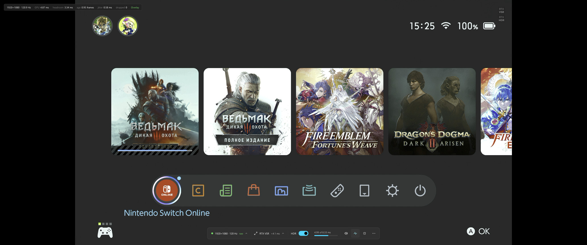
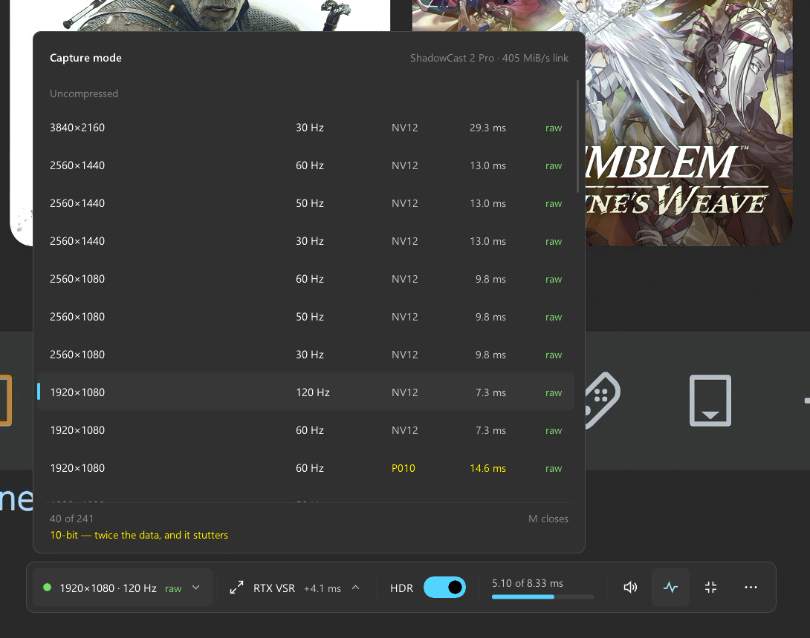
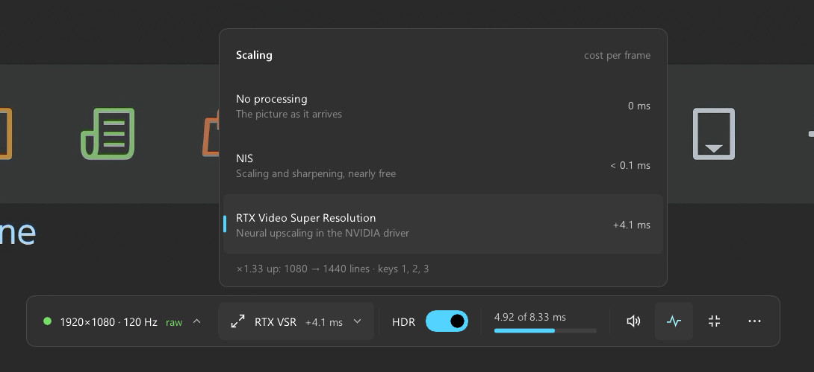

<p align="center">
  
</p>

<h1 align="center">Rayxel</h1>

<p align="center">
  A low-latency Windows viewer for USB capture cards, for playing a console on a PC monitor.<br>
  RTX Video Super Resolution, RTX Video HDR and NIS — with the measured cost of each.
</p>

<p align="center">
  <a href="../../releases/latest">Download</a> ·
  <a href="#getting-started">Getting started</a> ·
  <a href="#controls">Controls</a> ·
  <a href="#building">Building</a> ·
  <a href="FINDINGS-LATENCY.md">Latency findings</a>
</p>

<p align="center">
  
</p>

<table>
  <tr>
    <td width="50%"></td>
    <td width="50%"></td>
  </tr>
  <tr>
    <td><sub>Capture modes, uncompressed first, with the time each takes on the USB wire.</sub></td>
    <td><sub>Scaling, with what each option costs per frame.</sub></td>
  </tr>
</table>

---

Rayxel shows the picture from a USB capture card — a Nintendo Switch 2 or a Steam Deck on a
Genki ShadowCast 2 Pro is what it was built for, but nothing in it is specific to that card.
Someone is *playing* through this window, so it treats input lag as the thing being
measured: every option says what it costs in milliseconds of the frame budget, and every
number it shows is one it can actually measure.

## Features

- **Low-latency presentation.** A Direct3D 11 flip-model swapchain that reaches a hardware
  overlay plane in borderless full screen, and one present per captured frame, so a VRR
  display refreshes exactly when a picture arrives.
- **Upscaling and HDR.** RTX Video Super Resolution, RTX Video HDR (SDR to HDR) or NVIDIA
  Image Scaling, each listed with its measured per-frame cost. Output follows the Windows
  HDR state.
- **Capture modes that tell the truth.** Windows reports some modes as uncompressed `NV12`
  when the card is actually sending JPEG. Rayxel detects them with two independent tests,
  hides the ones that only duplicate a real raw mode, and marks every mode with a codec on
  the wire as `zip`. It measures the card's USB link instead of assuming it, and shows how
  long each mode takes to cross it.
- **Live telemetry.** One line to play with: the rate the picture arrives at, its delay as
  a single figure, and what Rayxel's own work takes out of the frame. Or a full card that
  shows what those are made of — the delay stage by stage (encoder, network and decoder for
  a source on the network), GPU and CPU time and headroom, a frame-time graph with jitter,
  late and lost frames, and whether the window is on an overlay plane or being composed by
  Windows. Trouble joins the line only while it is trouble.
- **Out of the way.** A Windows 11–style control bar at the bottom that appears when the
  mouse moves and hides itself, with the pointer, five seconds after it stops. A gamepad
  never brings it up.
- **HDMI audio passthrough** from the card to any output, with drift correction.
- **Five languages:** English, Russian, Ukrainian, German, Spanish.

## Requirements

- Windows 10 or 11, x64.
- A UVC capture card that offers `NV12` or `P010` (tested with the Genki ShadowCast 2 Pro).
- For RTX Video Super Resolution and RTX Video HDR: an NVIDIA RTX GPU and a recent driver.
  HDR output needs HDR turned on in Windows.
- For VRR: a G-SYNC or FreeSync monitor, with VRR enabled for windowed and full-screen
  applications in the NVIDIA control panel.

## Getting started

Download `Rayxel.exe` from the [latest release](../../releases/latest) and run it. It is a
single self-contained executable: nothing to install, no .NET runtime needed. The first
launch takes about a third of a second longer while it unpacks.

Rayxel picks the best capture device it can find, opens the fastest uncompressed mode, and
remembers what you chose for next time.

**Press F11.** In a normal window the Windows compositor adds a whole frame — 8.3 ms at
120 fps, more than RTX VSR and RTX Video HDR together. Borderless full screen reaches a
hardware overlay plane instead. The telemetry card says which one you have: `Overlay` is
good, `Composed` costs a frame — and while it is `Composed`, the one-line readout and a red
badge on the control bar say so too.

## Controls

Move the mouse over the picture to bring up the control bar:

- **Capture mode** — resolution and rate, with a dot in the wire's colour: green when the
  picture arrives uncompressed, amber when a codec carries it. Opens the list of modes,
  where every mode says `raw` or `zip`.
- **Scaling** — rows of settings, as in a game's graphics menu. The technique comes from a
  dropdown that gives each one's cost per frame: off, NIS, RTX VSR, DLSS, FSR. Point at a
  row, or walk the list with the arrow keys, and what that row is appears beside it; one
  that cannot be used stays in the list, greyed, and says why there. Under it is whatever
  belongs to the one chosen: NIS's sharpness, DLSS's model. The model's box shows the one
  that is running. When the driver's own DLSS override names the model, nothing chosen in
  Rayxel would be obeyed, so the box is shut and the reason is written under it together
  with where in the NVIDIA app to switch that off. What concerns a row as a whole is
  behind the **ⓘ** beside its label. FSR has its place in the list but no backend in this
  build yet.
- **Frame generation** — the same rows for the same kind of choice: the generator, and how
  many frames it shows for each one that arrives. **Nothing is behind it yet**: it needs
  Direct3D 12, so the generators are greyed and it can only be off. The info marks say
  why, and what a multiplier would come to on this display.
- **HDR** — RTX Video HDR on or off; explains itself when it is unavailable.
- **Audio, telemetry, full screen**, and **…** for device, audio routing, HDR brightness,
  window mode and language.

| Key | |
|---|---|
| `Esc` / `Tab` | show or hide the bar; `Esc` closes whatever is open first |
| `T` | telemetry: off → one line → full card |
| `M` | capture-mode list |
| `1` / `2` / `3` / `4` / `5` | no scaling / NIS / RTX VSR / DLSS / FSR; one that cannot be used opens the list, which says why |
| `G` | frame generation |
| `↑` / `↓`, `Enter` | in an open list: walk its rows, take the one you are on; `Esc` closes the list |
| `H` | RTX Video HDR |
| `[` / `]` | NIS sharpness |
| `F11` | window → borderless full screen → topmost full screen |
| `F1`, right click | the full mode menu |

Closing the window asks first, so a stray key never ends a game.

## Where it keeps things

```
%LOCALAPPDATA%\Rayxel\settings.json     what you last chose
%LOCALAPPDATA%\Rayxel\logs\             one rolling log per run
```

## Command line

Everything is optional; the app needs no arguments.

| Flag | |
|---|---|
| `--list` | probe every capture device, print what it can do, and exit |
| `--device=<name\|index\|path>` | use a specific device instead of choosing |
| `--lang=en\|ru\|uk\|de\|es` | start in a language |
| `--borderless` | start in borderless full screen |
| `--tele` | start with the telemetry up |
| `--mode=<w>x<h>@<fps>` | start in a specific mode, e.g. `--mode=1920x1080@120` |
| `--scaler=none\|nis\|vsr\|dlss` | start with a specific scaler |
| `--no-auto-hdr` | do not follow the Windows HDR state at start-up |
| `--pacing=arrival\|refresh` | present once per captured frame (default), or on every swapchain slot |
| `--bench[=<seconds>]` | measure for a fixed time (default 20 s), log percentiles, and exit |
| `--console` | attach to the terminal it was started from and print the log there |
| `--verbose` | debug-level logging |
| `--shot=<file.png>` | render for a few seconds, save the frame as a PNG, and exit |
| `--screen=<name>` | force a state for inspection: `splash`, `devices`, `app`, `nosignal`, `busy`, `composed`, `modes`, `scaler`, `scaler-list`, `scaler-variants`, `scaler-info`, `framegen`, `framegen-list`, `framegen-info`, `more`, `quit` |

`--shot` saves the back buffer rather than the screen, so it works even when the window is
covered or on a display nobody is looking at.

## Building

Requires the .NET 10 SDK on Windows.

```
dotnet build Rayxel.slnx -c Release
```

To produce the single-file executable:

```
dotnet publish src/Rayxel/Rayxel.csproj -c Release -r win-x64 --self-contained -o publish
```

The runtime identifier belongs on that command line and not in the project file: as a
project property it moves every ordinary build into a `bin\...\win-x64\` subfolder and
leaves the previous executable at the old path, where it goes on being launched.

The result is exactly one file, `Rayxel.exe`, about 40 MB. NVIDIA's NIS shader sources, the
native `cimgui.dll`, the window icon and the debug symbols are all embedded, so stack traces
keep file and line numbers without a separate `.pdb`. Trimming is off on purpose: Vortice,
NAudio and `System.Text.Json` resolve types by reflection, and a trimmed build fails at
runtime rather than at build time.

## How it works

Media Foundation reads the card straight into Direct3D 11 textures. From there the frame
goes through the driver's video processor (RTX VSR and RTX Video HDR), the NIS compute
shader, DLSS, or Rayxel's own YUV-to-RGB shader, and is presented on a flip-model swapchain.
DLSS needs to be told how the picture moved, which a video does not say, so Rayxel
estimates it from one frame to the next with a shader of its own. The
interface is Dear ImGui, drawn into the same swapchain rather than in a window of its own —
a second window over the video would take it off its overlay plane and cost a frame.

The measurements behind the design are written up in
[FINDINGS-LATENCY.md](FINDINGS-LATENCY.md) (where every millisecond goes, from the USB wire
to the present) and [FINDINGS-USB.md](FINDINGS-USB.md) (what the card's own descriptors say
about its modes). [DESIGN-BRIEF.md](DESIGN-BRIEF.md) describes what the interface has to do
and why.

## Known limitations

- **End-to-end latency cannot be measured in software.** The card's own delay before it
  timestamps a frame and the monitor's after a present are both invisible; anything Rayxel
  cannot measure is shown as `n/a` rather than estimated.
- **Intel VSR is written but has never run on Intel hardware.**
- **DLSS works from estimated motion.** A game gives DLSS exact motion vectors, depth and a
  camera that shifts by a fraction of a pixel every frame; a video has none of these.
  Rayxel estimates the motion, supplies a flat depth, and cannot supply the shift, so DLSS
  here steadies and cleans the picture rather than recovering detail that was never sent,
  and it smears where the estimate is wrong.
- **DLSS needs an NVIDIA RTX card and a copy of `nvngx_dlss.dll`,** which is not part of
  Rayxel. The driver uses one placed beside `Rayxel.exe` (it comes with NVIDIA's DLSS SDK),
  or its own copy - which it only lends to a program it does not know while DLSS override
  is switched on for all programs in the NVIDIA app. The driver's settings may also replace
  the model and mode Rayxel asks for; the log says what was used.
- **Two identical capture cards cannot be told apart for audio:** a WASAPI endpoint does not
  expose the hardware instance under it. The audio input selector exists for that case.
- **Hot-plug is noticed lazily,** when a device list is opened.
- **One set of settings,** not a profile per console or game.
- Only `NV12` and `P010` can be displayed; other formats and modes slower than 30 fps are
  left out of the menus.

## License

Rayxel is released under the [MIT License](LICENSE).

It includes or uses NVIDIA Image Scaling (`src/Rayxel/Render/NIS/`, MIT, © NVIDIA
Corporation), Dear ImGui through ImGui.NET (MIT), NAudio (MIT) and Vortice.Windows (MIT).
DLSS is NVIDIA's and no part of it is included: Rayxel calls the copy the graphics driver
runs.

NVIDIA, RTX and G-SYNC are trademarks of NVIDIA Corporation; Nintendo Switch is a trademark
of Nintendo; Steam Deck is a trademark of Valve; ShadowCast is a trademark of Genki.
Rayxel is not affiliated with or endorsed by any of them.
